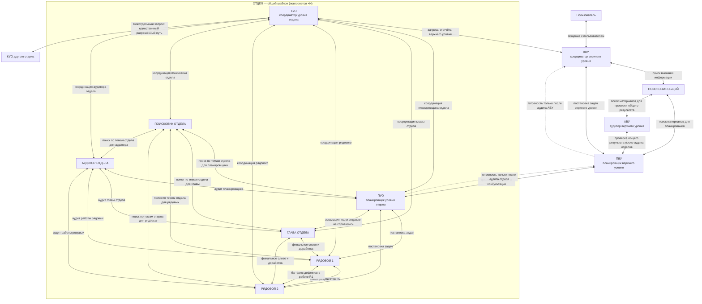

# Граф взаимодействий агентов

Обязателен к прочтению каждым агентом до начала работы. Рёбра показывают, кто с кем
взаимодействует и зачем; связь, которой нет на графе, не создаётся молча.

## Обязательные ворота

- ПУО не сообщает ПВУ о готовности, пока не пройден аудит в отделе.
- ПВУ не сообщает КВУ о готовности, пока не пройден аудит АВУ.
- АВУ проверяет общий результат строго после аудиторов отделов.
- Отделы напрямую не взаимодействуют: запрос идёт через КУО.
- Координатор может общаться с любым агентом по просьбе пользователя.
- Рядовой разжёвывает задачу до шагов до начала исполнения; шаг проверяется сразу.
