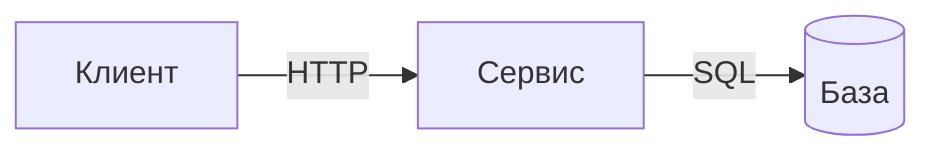

# Диаграмма

Скопировать в `diagrams/<тема>.md`. Схема отвечает на один вопрос (`DOC-POL-11`), хранится текстом (`DOC-POL-10`).

**Если данных нет:** строить по коду, а не по памяти; расхождение — `Q-*`.

````markdown
---
id: diagram.<тема>
title: "<Вопрос, на который отвечает схема>"
type: diagram
status: draft
authority: illustrative
visibility: internal
---

# <Вопрос, на который отвечает схема>

**Отвечает на вопрос:** <один вопрос>.
**Источник:** `<файл или документ>`.



## Обозначения

| Элемент | Что значит |
| --- | --- |

## Что не показано

Сознательно убранное, чтобы схема осталась читаемой.
````
