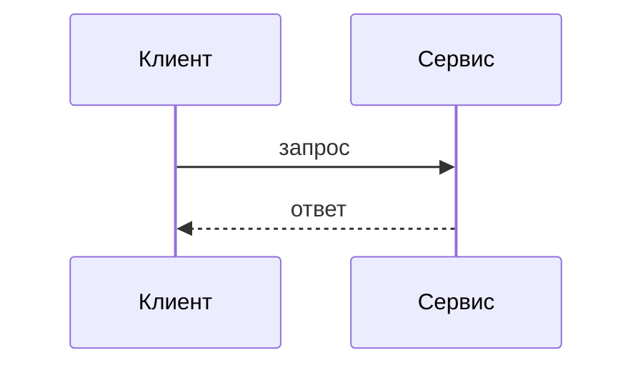

# Техническая спецификация

Скопировать в `specs/<система>/<подсистема>.md`. Спецификация отвечает на вопрос «как устроено и почему так», но не заменяет контракт модуля.

**Если данных нет:** `[?] Q-*`, не выдумывать протоколы и форматы.

````markdown
---
id: spec.<система>.<подсистема>
title: "Спецификация: <подсистема>"
type: spec
status: draft
authority: normative
visibility: internal
---

# Спецификация: <подсистема>

## Назначение и границы

Что делает, чего не делает, от чего зависит.

## Компоненты

| Компонент | Ответственность | Контракт |
| --- | --- | --- |

## Потоки



## Данные

| Сущность | Поля | Владелец | Срок жизни |
| --- | --- | --- | --- |

## Отказы и деградация

| Ситуация | Поведение | Как узнать |
| --- | --- | --- |

## Требования

Ссылки на `REQ-*` из ТЗ, которые реализует эта подсистема.

## Открытые вопросы

- `Q-*`
````
