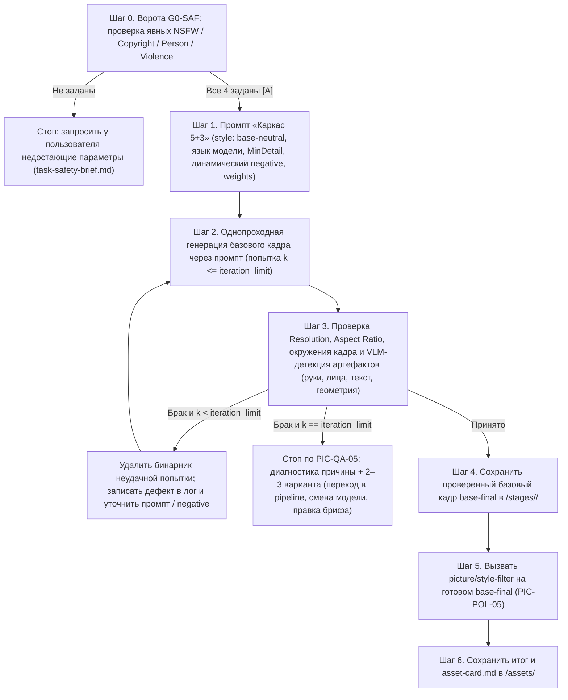

# `picture/instant`

Однопроходный рабочий процесс: каждый шаг генерации сразу создаёт одно целое базовое изображение сцены через промпт, проверяет его VLM и при необходимости уточняет промпт вплоть до `Iteration Limit`, после чего один раз накладывает целевой фильтр стиля. Все артефакты размещаются в `<picture_root>` (`root_paths` манифеста активного домена `picture`, вне подмодуля HYAI для внешних проектов — `PIC-POL-06`).

## Пошаговый регламент

1. **Ворота безопасности и рамок качества (`G0-SAF`, `PIC-SAF-01..05`).** Проверить, что пользователь явно задал для задачи или сессии все четыре правила безопасности (`safety_nsfw`, `safety_copyright`, `safety_person`, `safety_violence`). Если хотя бы один параметр отсутствует — работа не начинается; агент задаёт один сгруппированный вопрос по шаблону [`../templates/task-safety-brief.md`](../templates/task-safety-brief.md). Одновременно фиксируются `min_resolution`, `allowed_aspect_ratios`, `iteration_limit` и целевой стиль.
2. **Конструирование базового промпта (`PIC-POL-01..02`, `PIC-PRM-01..05`).** В `<picture_root>/prompts/<slug>-base.md` заполняется спецификация «Каркаса 5+3» на едином языке модели (`en` по умолчанию):
   - секции `subject`, `environment`, `lighting`, `camera` несут полную предметную детализацию (не короче `min_tokens` для сложных сцен);
   - в паспорте промпта заполнены `env_canon_source` и `env_anchor_ids`, а пять осей окружения (`PIC-ENV-02`: свет звезды, флора, небо, небесные тела, локальные тёплые источники) стоят в `environment`/`lighting` дословными блоками канона либо с пометкой `not applicable` и причиной (`PIC-PRM-06`);
   - секция `style` ставится в режим `base-neutral` (чистая читаемая форма и материалы без финального художественного фильтра — `PIC-POL-05`);
   - секция `negative` собирается динамически из базовых анти-артефактов, уязвимых мест текущей сцены и активных барьеров безопасности;
   - блок `weights` явно расставляет веса в нативном синтаксисе выбранной модели.
3. **Цикл однопроходной генерации и VLM-проверки (`PIC-POL-03..04`, `PIC-QA-01..03`, `PIC-QA-05`).** На каждой попытке `k` (`1 <= k <= iteration_limit`):
   - кадр создаётся целиком строго через записанный промпт;
   - проверяются фактическое разрешение (`>= min_resolution`), пропорции (`allowed_aspect_ratios`) и четыре оси VLM-детекции (`hands`, `faces`, `text`, `geometry`), а при участии в серии — сверка с `series-anchor` (`PIC-QA-04`);
   - отдельно проверяется окружение кадра по пяти осям `PIC-ENV-02` с отметкой `env_ok` (`PIC-QA-06`): земной свет, зелёная листва, земное небо или одна луна там, где канон говорит иное, — такой же брак, как лишний палец;
   - если найден дефект и `k < iteration_limit`, бинарник неудачной попытки **немедленно удаляется**, причина записывается одной строкой в журнал итераций промпта, меняются релевантные секции/веса/`negative` и выполняется следующая попытка;
   - если `k == iteration_limit` и кадр не принят, цикл останавливается без сохранения бракованных рендеров с предложением перехода в [`pipeline.md`](pipeline.md) либо корректировки условий.
4. **Фиксация принятого базового звена (`PIC-POL-04`).** Прошедшее приёмку базовое изображение сохраняется как принятое звено `base-final` в `<picture_root>/stages/<slug>/` вместе со ссылкой на сработавший промпт.
5. **Наложение фильтра стиля в самом конце (`PIC-POL-05`).** Только после приёмки `base-final` выполняется заключительный проход [`style-filter.md`](style-filter.md). Если бриф изначально требует нейтрального фотографического/технического вида без дополнительной художественной стилизации, это явно отмечается в карточке (`style_filter_applied: none-by-brief`), и `base-final` переходит в финальный ассет.
6. **Паспортизация.** Готовый файл и заполненный [`../templates/asset-card.md`](../templates/asset-card.md) размещаются в `<picture_root>/assets/` со статусом `review` (`HYAI-PERM-N05`).
