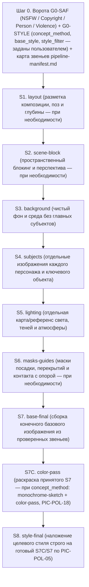

# `picture/pipeline`

Декомпозиционный рабочий процесс для сложных, многосубъектных и композиционно строгих задач. Вместо попытки угадать всю сложную сцену за один бросок агент создаёт через отдельные промпты промежуточные звенья, проверяет каждое звено на соответствие исходному запросу, сохраняет принятые звенья, удаляет неудачные попытки, собирает конечное базовое изображение `base-final` и только в самом конце применяет фильтр стиля.

## Полный каталог промежуточных звеньев (`S1..S8`)

Каждое активированное звено порождается **собственным промптом** каркаса «5+3» (`PIC-POL-01`), проходит индивидуальный цикл VLM-проверки до `iteration_limit` (`PIC-WF-02`), при приёмке сохраняется в `<picture_root>/stages/<slug>/` (`<picture_root>` — `root_paths` манифеста активного домена `picture`, вне подмодуля HYAI для внешних проектов — `PIC-POL-06`), а при отбраковке немедленно удаляется (`PIC-POL-04`). На звеньях `S1..S7` секция `style` работает строго в режиме `base-neutral` (`PIC-POL-05`). Звено `S7C` — раскраска базы: оно тоже не является целевым стилем, а наводит палитру и материалы проекта на принятое монохромное `S7` при замке содержания (`concept_method`, `PIC-POL-18`).

| Код | Звено (`stage_kind`) | Обязательность | Что создаётся через отдельный промпт | Что проверяет VLM до перехода к следующему звену |
| --- | --- | --- | --- | --- |
| `S1` | `layout` — разметка и каркас | По потребности (сложные позы, >= 3 фигур, жёсткая сетка кадра) | Композиционная схема планов, контур поз/силуэтов, карта глубины и свободных зон | Пропорции `Aspect Ratio`, читаемость силуэтов, отсутствие наложения ключевых фигур друг на друга |
| `S2` | `scene-block` — блокинг сцены | По потребности (сложная архитектура, интерьер, многоплановая перспектива) | Геометрический каркас сцены: горизонт, точка схода, крупные объёмы и масштабные ориентиры | Единая точка/линия схода перспективы, правдоподобный масштаб укрытий, мебели и проёмов |
| `S3` | `background` — чистый фон | Обязательно в `pipeline` | Полная среда/локация заднего и среднего плана без главных персонажей и фокусных предметов | Целостность окружения, отсутствие случайных фигур/надписей, наличие опорных площадок под `S4`; оси окружения `PIC-ENV-02` — флора, небо, небесные тела — совпадают с якорями канона (`env_ok`) |
| `S4` | `subjects` — персонажи и объекты | Обязательно (отдельное звено на каждого значимого субъекта/предмет) | Изолированное базовое изображение каждого персонажа, существа или ключевого предмета в целевом ракурсе | Анатомия кистей и лиц (`PIC-QA-03`), точность костюма/деталей по запросу, совпадение с `series-anchor` (`PIC-QA-04`) |
| `S5` | `lighting` — карта света и атмосферы | Обязательно при направленном, контровом или многоисточниковом свете | Отдельная светотеневая и цветотемпературная карта сцены (`key / fill / rim`, лучи, туман, рефлексы) | Согласованность вектора света с геометрией `S2/S3`, отсутствие противоречащих направлений теней; цвет и жёсткость света соответствуют звезде канона, тёплый свет только от названных источников (`PIC-ENV-02.1`, `PIC-ENV-02.5`) |
| `S6` | `masks-guides` — маски контакта и перекрытий | По потребности (сложные перекрытия планов, вода, стекло, отражения) | Карта зон размещения `S4` поверх `S3`, линий заслонения (`occlusion`) и пятен контактных теней | Плотная посадка субъектов на опору без эффекта «парения в воздухе», верный порядок планов |
| `S7` | `base-final` — конечное базовое изображение | Обязательно в `pipeline` | Сводный промпт полной сцены (`MinDetail`), собирающий проверенные звенья `S1..S6` в единый базовый кадр (`style: base-neutral`) | Полное соответствие исходному запросу, бесшовное слияние субъектов со средой и светом `S5`, отсутствие артефактов рук/лиц/текста |
| `S7C` | `color-pass` — раскраска базы | Обязательно при `concept_method: monochrome-sketch + color-pass` (`PIC-POL-18`), иначе `skipped-by-design` | Промпт раскраски принятого `S7`: палитра и материалы проекта (якоры окружения, цветовые коды костюмов, материалы сцены) при замке содержания — «раскрасить, а не перерисовывать»: все контуры, позы, предметы и композиция сохраняются | Полное сохранение композиции, лиц, кистей, предметов и позиций `S7` (сверка бок-о-бок + замерами, `PIC-QA-09`); палитра совпадает с якорями (`env_ok`); «пустые» поверхности (страницы, доски, вывески) остались пустыми; рамки 0, текст 0 |
| `S8` | `style-final` — финальный фильтр стиля | Обязательно при наличии целевого стиля (`PIC-POL-05`) | Заключительный промпт [`style-filter.md`](style-filter.md) поверх принятого `S7C` (или `S7`, если `S7C` пропущен) с замком содержания | Точная передача целевого стиля при сохранении проверенной композиции, лиц, кистей и текста из `S7C`/`S7` |

## Правила работы внутри конвейера

1. **Ворота старта (`G0-SAF`, `G0-STYLE`) и предвызовной контекст.** До запуска `S1` проверяется явное наличие всех четырёх правил безопасности (`NSFW`, `Copyright`, `Person`, `Violence`, `PIC-SAF-01`) и явных ответов пользователя на три стилевых вопроса: `concept_method` — способ генерации концепт-арта (рабочая среда базы, `PIC-POL-18`), `base_style` — вид базового изображения (`PIC-POL-07`), `style_filter` — финальный фильтр или явный отказ (`PIC-POL-08`). Без всех шести величин конвейер не запускается. Затем создаётся карта конвейера по шаблону [`../templates/pipeline-manifest.md`](../templates/pipeline-manifest.md), где отмечается список активных звеньев задачи (включая `S7C` при скетч-базе). Перед каждым image tool call для каждого активного звена и каждой повторной попытки отдельным сообщением сообщать `Проблема` и `Цель генерации`; на повторе дополнительно указывать наблюдаемый дефект, конкретное изменение текущего звена и ожидаемую проверку (`PIC-POL-15`).
2. **Окружение кадра (`PIC-ENV-02..03`).** Звенья `S3` (среда) и `S5` (свет) — носители окружения: на них проверяются флора, небо, небесные тела и свет звезды по якорям канона, и без `env_ok` переход дальше не открывается. Дефект окружения чинится перегенерацией `S3`/`S5`, а не подкрашиванием на `S7` или `S8`.
3. **Локализационная дисциплина (`PIC-WF-02`).** Если на сборке `S7` обнаруживается дефект позы персонажа, исправляется и перегенерируется звено `S4` (с обновлением промпта `S4`), после чего повторяется `S7`; замазывать анатомический брак на этапе `S8` запрещено.
4. **Чистота хранилища (`PIC-POL-04`).** В `<picture_root>/stages/<slug>/` остаются **ровно принятые версии** каждого активного звена (`s1-layout`, `s3-background`, `s4-subject-01`, …, `s7-base-final`) и их промпты в `<picture_root>/prompts/`. Все промежуточные неудачные рендеры удаляются немедленно после отклонения на VLM-проверке.
5. **Фотореалистичный `S8` (`PIC-POL-13`).** Если `style_filter` — фотореализм и поручение на него не дано, конвейер завершается на принятом `S7 base-final` (и принятом `S7C`, если он активен), а `S8` выполняется владельцем вручную по пакету `handoffs/`; звено `S8` в карте конвейера помечается `owner-manual`, и его отсутствие не является незавершённостью работы агента.
6. **Паспортизация.** Финальный результат `S8` и карточка [`../templates/asset-card.md`](../templates/asset-card.md) со ссылками на все принятые звенья конвейера сохраняются в `<picture_root>/assets/`.
7. **Edit-цепочка от раскладки (рабочая форма звеньев).** Для связной сцены допустима и экономнее пересборка каждого звена с нуля: `S1` создаётся генерацией с нуля (text-to-image), а звенья `S3`, `S5`, `S6` и `S7` выполняются **edit-проходами по предыдущему принятому звену** с замком композиции: все фигуры, лица и предметы остаются на своих местах, проход правит только то, что названо в его промпте. Каждый edit-проход проверяется количественно, а не «на глаз» (`PIC-QA-09`): корреляция яркости с опорным звеном в пределах `0.85..0.99` (понижение при легитимных изменениях света/тона — с фиксацией причины) и **сверка позиций фоновых предметов**: проход может передвинуть мелкий предмет между поверхностями, поэтому проверяется не только наличие каждого предмета брифа, но и его место. Листы `S4` (персонажи/объекты) при edit-цепочке остаются отдельными генерациями и служат референсами идентичности, а не слоями вклейки.
8. **Замок «ровно одна фигура» в листах `S4`.** Генератор на «листе персонажа» может нарисовать дубль фигуры (два одинаковых персонажа в одном кадре). Промпт каждого листа `S4` обязан содержать явный замок единственного персонажа (на `prompt_language`: «EXACTLY ONE single person in the frame, no duplicate, no mirrored copy») и прохождение листа проверяется по счёту фигур (`PIC-QA-03`): две фигуры на одном листе — брак, лист перегенерируется.
