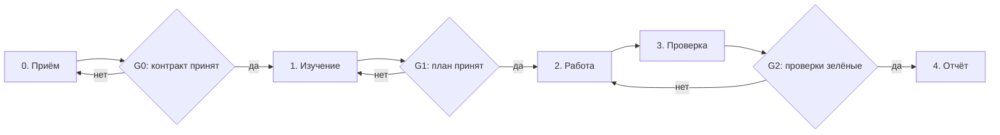

# `task` — выполнение задачи

Базовый процесс для любой согласованной работы. Частные процессы домена уточняют отдельные этапы, но не отменяют ворота.

## WF-00. Старт
1. Определить домен и профиль (`HYAI-INT-01..04`), объявить их. Если контракт не назвал пару «роль × призма», действует самая широкая пара своего домена (для `narrative` — `creator × omniscient`): узкая пара выбирается только явно, потому что она скрывает часть материала.
2. Собрать контракт задачи: `goal`, `non_goals`, `domain`, `profile`, `sources`, `outputs`, `acceptance`, `contour`, `stop_conditions`.
3. Прочитать: ядро (`permissions`, `provenance`), политику домена, политику профиля, `HYAI/meta/project.md`, архитектуру своего домена.
4. Проверить, не решена ли задача раньше: `HYAI/meta/decisions/`, `HYAI/meta/questions/`, `git log`.
5. План — 3–7 шагов, каждый с проверяемым результатом. План без критерия проверки — не план.

**Готово, когда** тип задачи назван, пара «роль × призма» известна, план показан, неясности сняты или вынесены списком, новых фактов не придумано.

**G0** — контракт согласован. Без него дальше нельзя. «Делай», «продолжай» — согласие; молчание — нет.

## WF-01. Изучение
1. Читать источники домена (`registry` домена), а не «всё подряд».
2. Факт без источника — `[?]` и вопрос, не догадка (`HYAI-INT-07`).
3. Проверить, нет ли уже решения по этому предмету в `HYAI/meta/decisions/<scope>/`.

**Готово, когда** каждый прочитанный источник назван, а не «посмотрел всё»; найденные противоречия показаны, а не разрешены молча.

## WF-02. План
1. Список файлов к изменению; для каждого — почему именно он.
2. Отметить `cross_scope`, если правка выходит за `scope_primary` профиля.
3. Указать, какие проверки докажут результат.

**Готово, когда** у каждого шага есть проверяемый результат.

**G1** — план согласован. Единственные ворота, которые нельзя обойти.

## WF-03. Работа
1. Минимальный дифф (`HYAI-PERM-A02`).
2. Сначала источник, потом производные: решение → карточка или документ → текст, комментарий, выгрузка. Производное не опережает источник.
3. Не смешивать в одном шаге содержательную правку и косметику: переименования, форматирование и массовые замены — отдельная задача (`HYAI-PERM-G04`).
4. Проверки запускаются сразу, не «в конце».
5. Нормативные документы (`invariant`, `contract`) — только с одобрением (`HYAI-PERM-G01`).
6. Если правка меняет правило, а не текст, — обновляется политика или процесс, а не только документ.

**Готово, когда** дифф минимален, источники обновлены раньше производных, содержательная правка не смешана с косметикой.

## WF-04. Проверка
1. `python3 HYAI/tools/run_checks.py` — полный конвейер.
2. Ручная проверка того, что не покрыто автоматикой: смысл, а не форма.
3. Для домена — свои проверки из `domains/<d>/manifest.yaml`.
4. Если проверка падает — исправить, а не отключить (`HYAI-PERM-N01`).

**Готово, когда** автоматика зелёная и ручная проверка смысла пройдена: проверка отвечает на «верно ли», а не «похоже ли».

## WF-05. Отчёт
1. `HYAI/meta/reports/<domain>/YYYY-MM-DD-<slug>.md` по шаблону `kernel/templates/report.md`.
2. Обязательные поля: `domain`, `profile`, `workflow`, `decisions`.
3. `cross_scope` — если были правки вне своей зоны.
4. Обновить `HYAI/meta/reports/README.md` и, если менялась норма, `HYAI/meta/decisions/`.

**Готово, когда** в отчёте есть цель, что сделано, чем проверено, что не сделано и что нужно от пользователя; «частичный успех» запрещён (`HYAI-INT-25`).

**G2** — отчёт пройден `check_report.py`.
**G3** — статус `approved` ставит владелец (`HYAI-PERM-N05`).

## Что не делает агент

- Не утверждает `status`, `authority`, `visibility`, `knowledge` за владельца (`HYAI-PERM-N05`, `HYAI-PERM-N12`).
- Не переписывает решения и не «улучшает» цитаты владельца.
- Не сдаёт работу без проверок и отчёта.
- Не выдаёт предложение за факт: `[Г]` остаётся `[Г]`, пока владелец не сказал иначе (`HYAI-PROV-01`).
