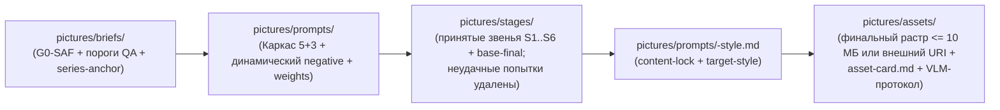

# Архитектура домена `picture`

Самодостаточный домен промптовой генерации изображений (`KIT-0003`). Управляет продуктовым деревом `pictures/` без зависимостей от других предметных доменов каркаса (`PIC-POL-06`).

## Раскладка продуктового каталога `pictures/`

| Подкаталог | Уровень `authority` | Что хранится | Кто ведёт (основной профиль) |
| --- | --- | --- | --- |
| `pictures/briefs/` | `brief`, `visual-canon` | Брифы задач и сессий с явными правилами безопасности (`G0-SAF`), эталоны серий (`series-anchor`) и спецификации отложенного фильтра стиля | `picture/art-director` |
| `pictures/prompts/` | `prompt` | Моноязычные спецификации промптов по структуре «5+3», карты весов, динамические `negative` и текстовые журналы итераций | `picture/instant` |
| `pictures/stages/` | `stage` | **Только принятые** промежуточные звенья (`S1..S6`), проверенные конечные базовые кадры `base-final` (`S7`) и манифесты `pipeline-manifest.md` | `picture/pipeline` |
| `pictures/assets/` | `stage` | Финальные изображения после `style-filter` (`S8`) и их паспорта `asset-card.md` с протоколами VLM-приёмки и `person_disclaimer` | `picture/instant`, `picture/pipeline` |

## Архитектурные инварианты (`PIC-INV-*`)

| ID | Инвариант | Чем обеспечивается |
| --- | --- | --- |
| `PIC-INV-01` | Ни одно изображение (звено, базовый кадр, стилизованный финал) не существует без породившего его документа промпта в `pictures/prompts/` | `PIC-POL-01`, шаблоны `prompt-spec.md` и `asset-card.md`, `check_links.py` |
| `PIC-INV-02` | Без четырёх явно заданных пользователем правил безопасности (`NSFW`, `Copyright`, `Person`, `Violence`) в `pictures/prompts/`, `pictures/stages/` и `pictures/assets/` не создаётся ни одного рабочего артефакта задачи | Ворота `G0-SAF` (`PIC-SAF-01`), правило `pic.unset-safety-placeholder` в `lint_terms.py` |
| `PIC-INV-03` | Каталог `pictures/stages/` хранит полный след принятых промежуточных звеньев и `base-final`, но нулевой объём отбракованных промежуточных рендеров | `PIC-POL-04`, правило `pic.rejected-artifact-stored` в `lint_terms.py` |
| `PIC-INV-04` | Художественный фильтр стиля отделён от синтеза содержания барьером `base-final`: все звенья до `base-final` включительно имеют `style_phase: base-neutral`, а `target-style` применяется только финальным проходом | `PIC-POL-05`, процесс `picture/style-filter`, правило `pic.premature-style-on-base` |

## Жизненный цикл данных между потоками

При размере растрового файла свыше `artifacts.no_binaries_over_mb` (`10 МБ`, `HYAI-ART-19`) бинарный оригинал хранится во внешнем хранилище проекта, а в `pictures/stages/` и `pictures/assets/` фиксируются Markdown-паспорта с `sha256`, размерами и постоянной ссылкой.
